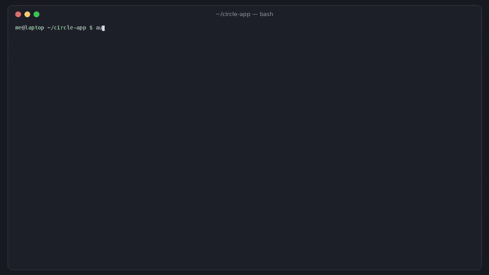

# authzprobe



[](https://github.com/hamarshehmhmd/authzprobe/actions/workflows/ci.yml)
[](LICENSE)


**Prove user A can't read user B's data before your Supabase app goes live.**

Apps built with Lovable, Bolt, v0, Cursor and friends talk straight from the browser to Supabase with a public key.
Whether a stranger can read every row depends entirely on row-level security policies that a model (or a tired
human) wrote. Linters catch RLS turned off. They don't catch a policy that *exists* but is wrong: "any logged-in user can
read all profiles", a guard that's inverted so anonymous requests get everything, or an update policy "fixed" with
`using (true)`. Those only show up when you actually try to read someone else's data.

`authzprobe` tries. It creates two throwaway users, seeds a row as user B, and checks whether **anon** and **user A**
can read, create-as-B, change or delete it. It also checks what a brand-new user (who owns nothing) can already see,
which private buckets can be listed, and whether a service key is sitting in your JavaScript. Every finding comes
with the SQL to fix it, and it runs in CI so the hole stays closed when the AI regenerates your schema.

```
table         rows   anon: sees  B's row   user A: sees  B's row
messages         2              2  R···                 0  ····
notes            1              0  ····                 0  ····
orders           2              2  RIUD                 2  RIUD
posts            1              1  R···                 1  R·U·    public by config
profiles         2              0  ····                 2  R···
sees = existing rows visible (a new user owns none) · B's row: R read I insert-as-B U update D delete · · = denied
```

### Why now

- **Nov 14 2026:** a scan of 159,041 Lovable projects found 7,403 sites where the public key returned tables with
  email addresses, including 200,000 private chats and passport numbers
  ([write-up](https://www.crissyfield.de/research/lovable-en/), [HN, 785 pts](https://news.ycombinator.com/item?id=50499017)).
  Lovable's head of security named insufficient RLS as the root cause.
- A Lovable app exposed 18,697 users because an AI-written check was inverted ([HN](https://news.ycombinator.com/item?id=47182659)).
- Escape found 2,000+ vulnerabilities in 5,600 vibe-coded apps, mostly misconfigured Supabase RLS
  ([methodology](https://escape.tech/blog/methodology-how-we-discovered-vulnerabilities-apps-built-with-vibe-coding/)).
- The Tea app leaked ID photos from a public storage bucket ([HN](https://news.ycombinator.com/item?id=44684373)).

## Install

One line (Python 3.9+, no dependencies):

```bash
pipx install git+https://github.com/hamarshehmhmd/authzprobe
```

or `pip install git+https://github.com/hamarshehmhmd/authzprobe`.

## Usage

> Only test projects you own or have permission to test. Point it at staging, a Supabase branch, or `supabase start`
> when you can. Full tests write throwaway rows (marked `authzprobe-<run id>`) and delete them afterwards.

**1. See what your deployed site exposes** (reads only your site's HTML and JS, sends nothing to Supabase):

```bash
authzprobe discover https://my-app.lovable.app
```

It prints the project URL, whether a public key was found, the tables, RPCs and buckets the code uses, and shouts if a
`service_role` / `sb_secret_` key is in the bundle.

**2. Full two-user test** with the service key (reads the schema, creates two throwaway users via the Auth admin API,
deletes them when done):

```bash
export SUPABASE_URL=https://abcd.supabase.co
export SUPABASE_ANON_KEY=...            # or sb_publishable_...
export SUPABASE_SERVICE_ROLE_KEY=...    # or sb_secret_...
authzprobe scan --public posts,products --fix-sql fixes.sql
```

**3. Local / CI with `supabase start`:** use the JWT secret instead and test users are minted, no Auth calls:

```bash
authzprobe scan --url http://127.0.0.1:54321 --anon-key "$ANON" --jwt-secret "$JWT_SECRET"
```

**4. Read-only, anon-only** (no service key, no writes): what can anyone with the public key read?

```bash
authzprobe scan --from-site https://my-app.lovable.app --i-own-this --no-seed
```

You can also bring two real test accounts with `--user-token A_JWT --user-token B_JWT`.

### What it checks

| ID | Severity | Check |
|---|---|---|
| AP001 | critical | `service_role` / `sb_secret_` key in the site's JavaScript |
| AP010 | high / critical* | anon key can read rows |
| AP011 | high / critical* | a brand-new user can read rows owned by other users |
| AP012 | medium | every signed-in user can read every row, and there's no owner column to tell whose they are |
| AP020 / AP021 | high / critical* | anon / user A can read the row seeded for user B |
| AP030 / AP031 | critical / high | anon / user A can change user B's row |
| AP040 / AP041 | critical / high | anon / user A can delete user B's row |
| AP050 / AP051 | high | anon / user A can insert a row that claims to be user B's |
| AP060 | high | anon or any user can list files in a private Storage bucket |
| AP061 | info / medium | bucket is public (medium if the name looks like IDs/documents/uploads) |
| AP070 | info | RPC functions exposed to the Data API (not called: they can have side effects) |
| AP002 | low | anon key can read the OpenAPI schema (self-hosted gateways; Supabase closed this in April 2026) |

\* critical when the table has sensitive-looking columns (email, phone, passport, address, messages, tokens ...).
Column *names* are reported; row values are never printed or stored.

Owner columns are guessed (`user_id`, `owner_id`, `created_by`, `author_id`, `profile_id`, ... and `id` on
`profiles`/`users`). Override with `--owner TABLE=COLUMN`. Mark intentionally public tables with `--public`.

Output: `--format text|json|markdown|github`, `--fix-sql FILE` writes the suggested SQL, `--fail-on SEVERITY` sets the
exit code (default `high`).

### GitHub Action

```yaml
- uses: hamarshehmhmd/authzprobe@v0.1.0
  with:
    url: ${{ secrets.STAGING_SUPABASE_URL }}
    anon-key: ${{ secrets.STAGING_SUPABASE_ANON_KEY }}
    service-key: ${{ secrets.STAGING_SUPABASE_SERVICE_ROLE_KEY }}
    public: posts,products
```

Findings show as annotations and a step-summary table. This repo's CI runs the action against the example app twice:
it must fail before `examples/vibeapp/fixed.sql` and pass after.

## Demo

[`demo.mp4`](https://github.com/hamarshehmhmd/authzprobe/releases/tag/v0.1.0) (narrated, about 2.5 minutes) runs it
on [`examples/vibeapp`](examples/vibeapp/schema.sql): a community app schema with five classic mistakes and one
table done right. Try it yourself (needs Postgres server binaries and a `postgrest` binary):

```bash
python scripts/localstack.py up      # real Postgres + PostgREST behind a Supabase-style gateway on :54321
# in another terminal, with the printed env vars:
authzprobe discover http://127.0.0.1:54321/
authzprobe scan --public posts
```

## Limits (honest list)

- Tenant/team scoping (`org_id`, memberships) isn't modeled yet: it tests user-vs-user ownership.
- Realtime channels and Edge Functions aren't tested. RPCs are listed, not called.
- Storage checks list bucket roots; they don't upload or download files. The local test stack simulates the Storage
  and Auth APIs (Postgres and PostgREST are real).
- Seeding fills required columns with simple values; rows that need specific foreign keys or check constraints are
  reported as "skipped" with the reason, not guessed at.
- Firebase isn't covered yet.

## Development

```bash
python -m venv .venv && .venv/bin/pip install -e ".[test]"
.venv/bin/pytest -q    # e2e tests run when Postgres + postgrest are installed (PG_BIN, POSTGREST)
```

## License

GNU AGPL-3.0-or-later (see [LICENSE](LICENSE)). Commercial licenses without the AGPL obligations are available from the
author, Mohammad Hamarsheh: open an issue or contact him via [GitHub](https://github.com/hamarshehmhmd).
